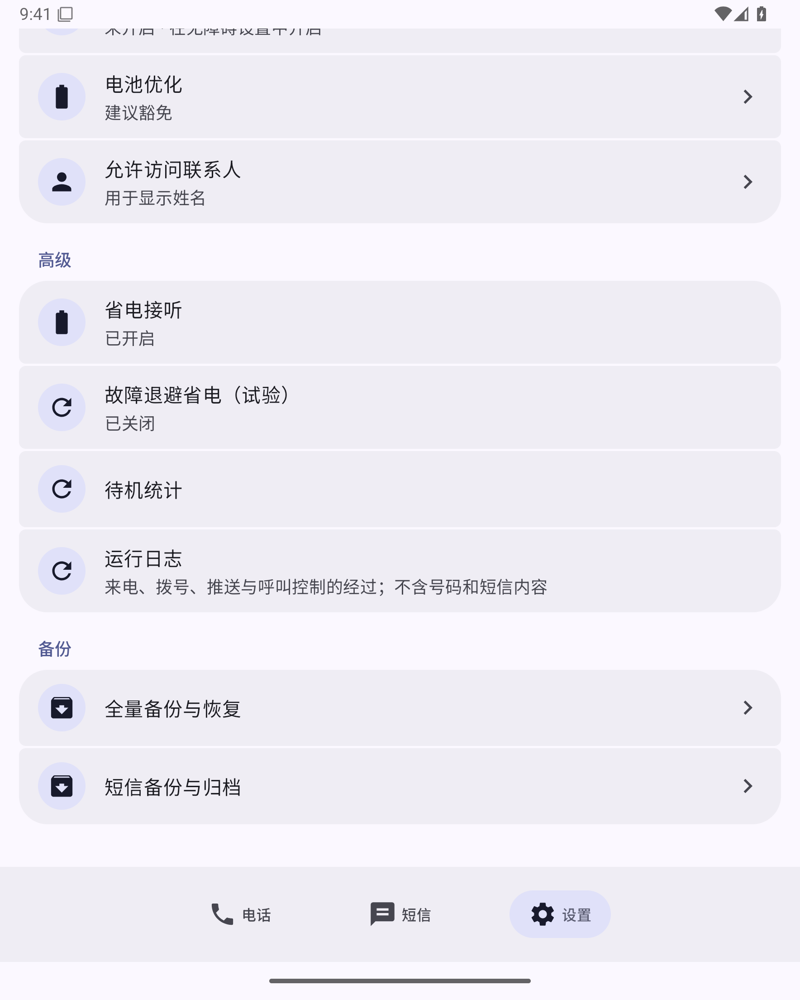
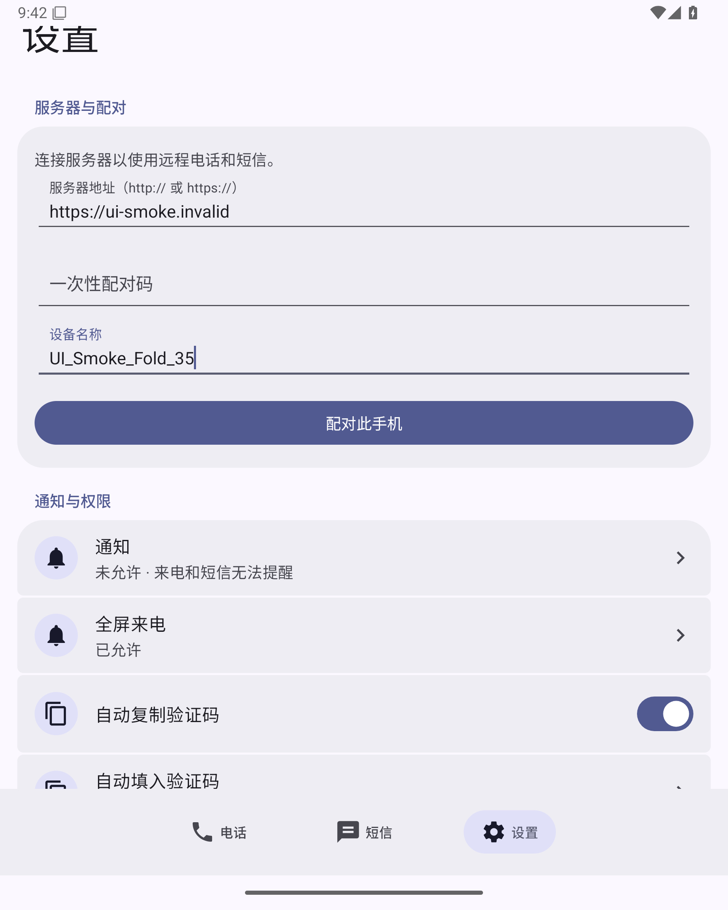
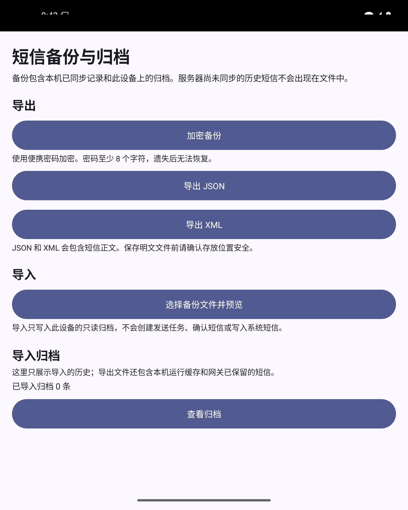
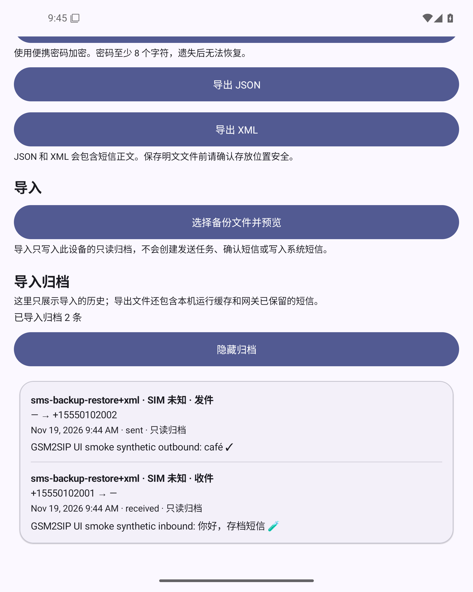
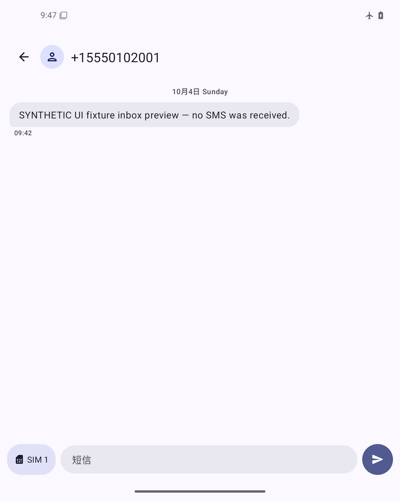
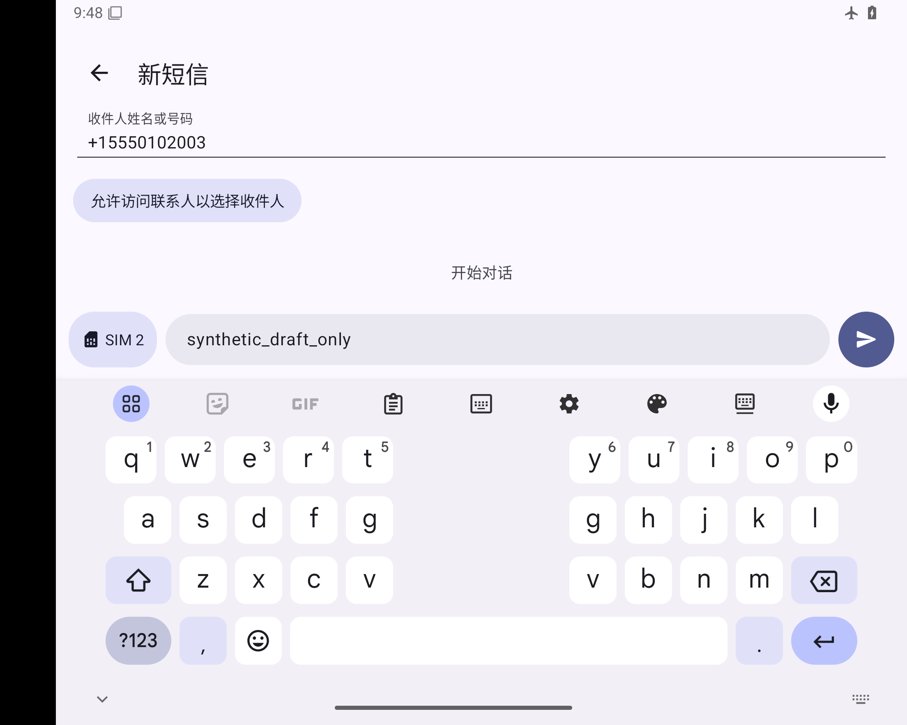
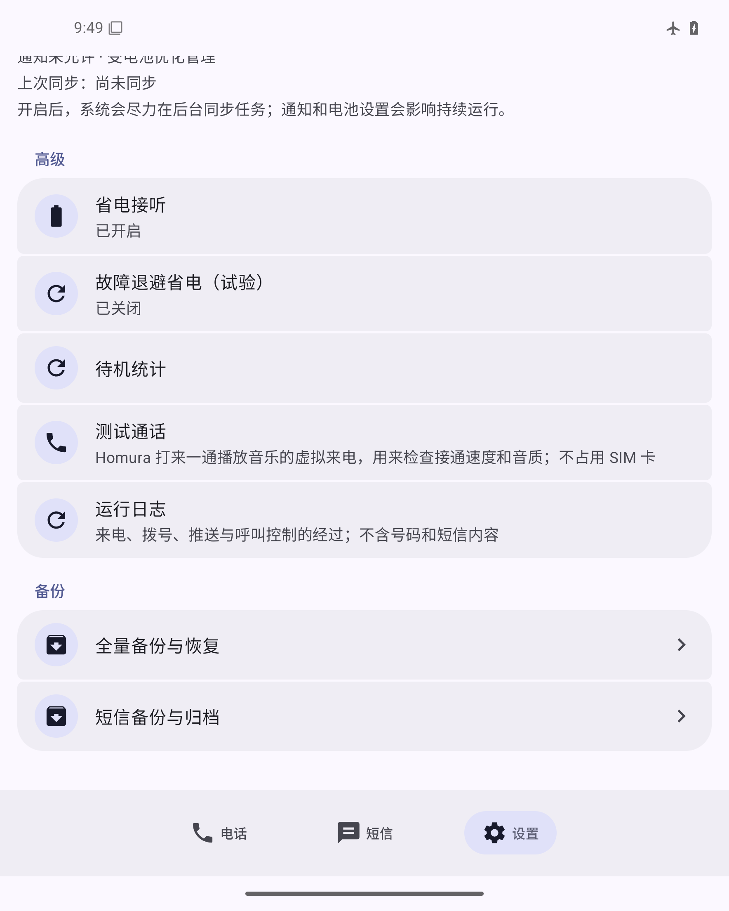
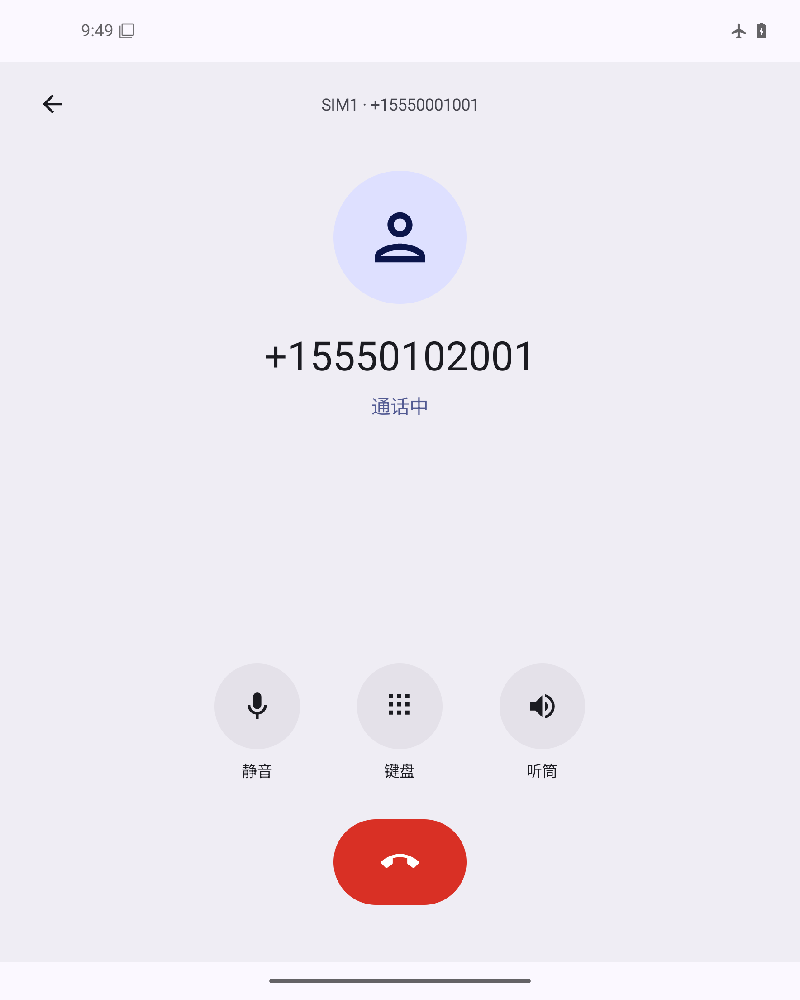
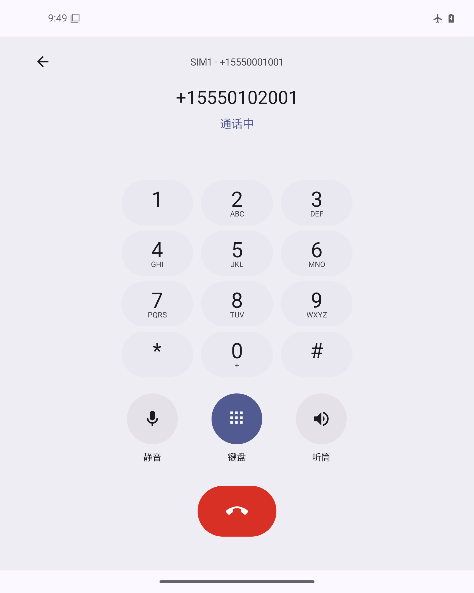
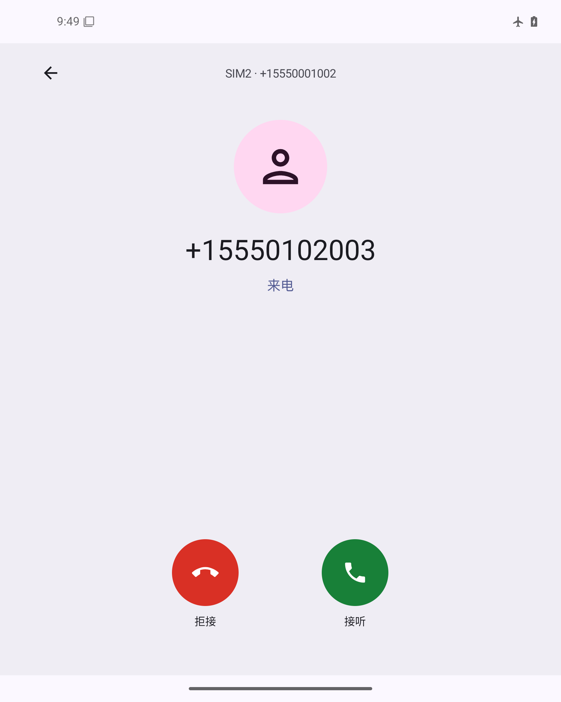

# Android 主机三标签 UI 验证

本报告由通过的 Android 35、7.6 英寸折叠屏 KVM UI smoke artifact 自动生成。截图是 artifact 中原始 PNG 字节的逐字节副本。

## 运行来源

- 仓库：`KiriKira/Madoka`
- 源提交：`fca178dfb1a722e8b46febce1c3ebea62ac95825`
- GitHub Actions run：[44498068532](https://github.com/KiriKira/Madoka/actions/runs/44498068532)
- artifact ID：`14517525579`
- artifact digest：`sha256:f532cf5dc73b45025514d133ce9aa5f523118006076bd232db7ea7869004cd1e`
- APK：`app-debug.apk`，SHA-256 `8be4312a3a2b4a2f75289bb75d60c52be7eda413ab5470c1989c0a3623a38ca5`，22532512 字节
- artifact 内未配对 smoke：`pass`（2026-11-19T09:45:54.459280+00:00）
- artifact 内配对 fixture：`pass`（2026-11-19T09:49:55.317507+00:00）
- 报告生成时间：`2026-11-19T09:50:12Z`

## 验证范围

未配对流程覆盖电话记录页、拨号键盘、短信列表、设置与备份入口，以及窗口旋转、折叠、展开和挖孔安全区。配对 fixture 使用离线合成的会话、两张 SIM、三条短信和通话记录；新建短信草稿经历 IME、旋转、折叠和展开。

四张出站准备、通话中、通话键盘和来电截图来自进程内合成 coordinator UI 状态；没有启动 SIP、Telecom、音频或蜂窝通话，未发送或接收短信。配对 fixture 结果要求 `fixture_active_call_ui=pass`。

本报告只验证 Android Emulator 上的界面流程，不代表 Z Fold8 真机、真实 SIM 短信收发、SIP 注册或双向语音已完成设备验收。

## 截图与文件校验

| 页面 | PNG | 尺寸 | 文件 SHA-256 |
|---|---|---:|---|
| 三标签导航 | [`images/host_navigation_initial.png`](images/host_navigation_initial.png) | 1768 × 2208 | `edd3ab92a0148d9c9962366838fd849051452530410028b8139a8128335fb6fd` |
| 未配对电话记录页 | [`images/host_call_history.png`](images/host_call_history.png) | 1768 × 2208 | `5ef079cbbb8cb13acc76acaeb57bb675981a27f99c4894d981b426c36cfbd9a5` |
| 独立拨号键盘 | [`images/host_dialpad.png`](images/host_dialpad.png) | 1768 × 2208 | `2a8127e56e7d9794d7024002c46db644b79475e3bb9ff3db547db0e35118c1c4` |
| 短信会话列表 | [`images/host_sms_thread_list.png`](images/host_sms_thread_list.png) | 1768 × 2208 | `06be81638a6e21f418e83eb3df765df89c4751449e95ad4130b8cb661b240a18` |
| 设置与配对表单 | [`images/host_settings_tab.png`](images/host_settings_tab.png) | 1768 × 2208 | `90a81c639c7702e03e900c7767d4a4654a62473a69bd6c3e1ee672abfa66e5f8` |
| 设置中的短信备份入口 | [`images/host_settings_backup_entry.png`](images/host_settings_backup_entry.png) | 1768 × 2208 | `018c94c82949e755d519bed627acc3f0bb45c1a7dd80387c54a32db27382ef90` |
| 主界面合拢窗口 | [`images/folded_ui.png`](images/folded_ui.png) | 1768 × 2208 | `4f1ca3c6d924ecffab56080186b2db36edda17808b0bf7a5523755a737a703d6` |
| 主界面展开窗口 | [`images/unfolded_ui.png`](images/unfolded_ui.png) | 1768 × 2208 | `46475c2fd57244afb7df353f6b388133aef9594ecdde7f367fa7785f39768d21` |
| 显示挖孔时的主界面 | [`images/hole_cutout_enabled.png`](images/hole_cutout_enabled.png) | 1768 × 2208 | `dfa4b9c4d8c5d478825c37c44f6d69768cf6d30c73c8bb859010d14efcbebe89` |
| 滚动后可见的备份入口 | [`images/main-backup-entry-host.png`](images/main-backup-entry-host.png) | 1768 × 2208 | `d48214d548ba8c134a1f99f9c4abc86f6a2939377fc163262fdef5e2e5c2b4f1` |
| 短信备份与归档页面 | [`images/backup-overview.png`](images/backup-overview.png) | 1768 × 2208 | `4293608cc37c4e951ede587c02cafa925ef690e22bbe3346dbe4b0ecae0d4d3e` |
| 备份页面横屏 | [`images/backup-rotation-landscape.png`](images/backup-rotation-landscape.png) | 2208 × 1768 | `c954cdb104fc0a285e3cd517985ce875fb4db206605df1ef11b598b0bf7729ea` |
| 备份页面竖屏 | [`images/backup-rotation-portrait.png`](images/backup-rotation-portrait.png) | 1768 × 2208 | `614843fd1c044e965f0f70aa6fb179a81591c1670af033f619acc356ede84e94` |
| 备份页面合拢 | [`images/backup-folded.png`](images/backup-folded.png) | 1768 × 2208 | `7d3942e4191caea8d78705ce4b1646059e0237690d60fbf07eec0304f81158f9` |
| 备份页面展开 | [`images/backup-unfolded.png`](images/backup-unfolded.png) | 1768 × 2208 | `614843fd1c044e965f0f70aa6fb179a81591c1670af033f619acc356ede84e94` |
| 挖孔安全区中的备份页面 | [`images/backup-cutout.png`](images/backup-cutout.png) | 1768 × 2208 | `614843fd1c044e965f0f70aa6fb179a81591c1670af033f619acc356ede84e94` |
| 合成短信归档导入预览 | [`images/backup-import-preview.png`](images/backup-import-preview.png) | 1768 × 2208 | `b4e293c46f88ca29719d6cbe6867e433755b9bc5cb1e6719a037d08bc8ca73dc` |
| 导入后的归档历史 | [`images/backup-imported-history.png`](images/backup-imported-history.png) | 1768 × 2208 | `527de9be07a5bb6321dbddbd56badc63e1ba2cca5c980b4b7b11f044535f7737` |
| 配对状态下的三标签 | [`images/paired-fixture/paired_three_tabs.png`](images/paired-fixture/paired_three_tabs.png) | 1768 × 2208 | `0b28e86f0b39adcdb2d64f8ee6034e2325e31e67fe679e96a0135312456b4880` |
| 双 SIM 合成通话记录 | [`images/paired-fixture/paired_call_history.png`](images/paired-fixture/paired_call_history.png) | 1768 × 2208 | `da8225c1829350bf846fab57c018c6c3b4722ec66bad9801ff37e8a45b029907` |
| 从通话记录预填号码的拨号页 | [`images/paired-fixture/paired_dialpad_from_history.png`](images/paired-fixture/paired_dialpad_from_history.png) | 1768 × 2208 | `55a4ea269ba06b664d42b4a749451d0fe495033fa4a58d9eaae960e67676db4a` |
| 配对状态下的独立拨号键盘 | [`images/paired-fixture/paired_dialpad.png`](images/paired-fixture/paired_dialpad.png) | 1768 × 2208 | `55a4ea269ba06b664d42b4a749451d0fe495033fa4a58d9eaae960e67676db4a` |
| 三条合成短信会话 | [`images/paired-fixture/paired_sms_threads.png`](images/paired-fixture/paired_sms_threads.png) | 1768 × 2208 | `6ab7e5dd178b72de69d9041cd5e31d7cc913fb62d07947a0705077bc96d24383` |
| 合拢窗口中的短信会话 | [`images/paired-fixture/paired_sms_threads_folded.png`](images/paired-fixture/paired_sms_threads_folded.png) | 1768 × 2208 | `21574bb8dfaeab0d4823d107488295c6bf3311e3aa18a1e3f10a0f9c22693ac0` |
| 展开窗口中的短信会话 | [`images/paired-fixture/paired_sms_threads_unfolded.png`](images/paired-fixture/paired_sms_threads_unfolded.png) | 1768 × 2208 | `957e17c3310e58cc94562a727de5075a371c810d1c6201984b0ecd69b65aeaaf` |
| 既有短信对话与回复框 | [`images/paired-fixture/paired_sms_conversation.png`](images/paired-fixture/paired_sms_conversation.png) | 1768 × 2208 | `eb35cc1ddffd2575f9271adabcb14c008da6e649c7c076ba5346b37a1c153ca3` |
| 新短信编辑页 | [`images/paired-fixture/paired_new_message.png`](images/paired-fixture/paired_new_message.png) | 1768 × 2208 | `43871937e5b5cd11992a352ac0a4e2399d678ddc2941acc33243065dd7708d2c` |
| 选择 SIM 2 的新短信页 | [`images/paired-fixture/paired_new_message_sim_b.png`](images/paired-fixture/paired_new_message_sim_b.png) | 1768 × 2208 | `d65c3b33d62a975e5659b4dd316b47c908690bc1a4b578fff05b085f0b16bd99` |
| 横屏且键盘显示时的短信草稿 | [`images/paired-fixture/paired_new_message_landscape.png`](images/paired-fixture/paired_new_message_landscape.png) | 2208 × 1768 | `9b0eb47e0eb15fbeb72825fe4f21ed43070f12fb3dc7f02d998bfbf02ac85ae2` |
| 合拢窗口中的短信草稿 | [`images/paired-fixture/paired_new_message_folded.png`](images/paired-fixture/paired_new_message_folded.png) | 1768 × 2208 | `8a022987ef1de78ed4bf6e4c36e84f825111edac60cd02f263604ce5b347865b` |
| 展开窗口中的短信草稿 | [`images/paired-fixture/paired_new_message_unfolded.png`](images/paired-fixture/paired_new_message_unfolded.png) | 1768 × 2208 | `d3465d091ce3c81a1937cc5bdb19994de7bca251721838d9ee58bf39bb139356` |
| 配对状态下的设置 | [`images/paired-fixture/paired_settings.png`](images/paired-fixture/paired_settings.png) | 1768 × 2208 | `91115e4beb0dea967456237ba305d510fa7cb34aa6dcaa60a2d20850c39ef4ab` |
| 配对设置中的短信备份入口 | [`images/paired-fixture/paired_settings_backup.png`](images/paired-fixture/paired_settings_backup.png) | 1768 × 2208 | `506df8918969b67a329f85a571d9bc7d6d732d5eaec6b44c136ae0989d5e4341` |
| 合成出站呼叫准备界面 | [`images/paired-fixture/call-synthetic-dialing.png`](images/paired-fixture/call-synthetic-dialing.png) | 1768 × 2208 | `3dba15b0e6b9d7aaa95fa024639cf6e32fa91ead28b4ea6ab533aa0d37ed7b0c` |
| 合成通话中界面 | [`images/paired-fixture/call-synthetic-active.png`](images/paired-fixture/call-synthetic-active.png) | 1768 × 2208 | `c8a2e3e9a5dc0967fbefa86cf60ee37e5bef4fefae947f5001ee1297e2fd5f22` |
| 合成通话键盘界面 | [`images/paired-fixture/call-synthetic-keypad.png`](images/paired-fixture/call-synthetic-keypad.png) | 1768 × 2208 | `37187392919190e28814ca505342e16984bfa862e511f8aa6c9d89c67b1d1dd4` |
| 合成来电界面 | [`images/paired-fixture/call-synthetic-incoming.png`](images/paired-fixture/call-synthetic-incoming.png) | 1768 × 2208 | `9ab82a0bbde64050fed144967ed0334bf0fe2f0c4a692a8652ef165cef7b403a` |

## 截图

### 未配对界面

#### 三标签导航

### 电话与拨号

#### 未配对电话记录页

#### 独立拨号键盘

### 短信

#### 短信会话列表

### 设置

#### 设置与配对表单

#### 设置中的短信备份入口

### 窗口适配

#### 主界面合拢窗口

#### 主界面展开窗口

#### 显示挖孔时的主界面

### 短信备份

#### 滚动后可见的备份入口

#### 短信备份与归档页面

#### 备份页面横屏

#### 备份页面竖屏

#### 备份页面合拢

#### 备份页面展开

#### 挖孔安全区中的备份页面

#### 合成短信归档导入预览

#### 导入后的归档历史

### 配对数据界面

#### 配对状态下的三标签

#### 双 SIM 合成通话记录

#### 从通话记录预填号码的拨号页

#### 配对状态下的独立拨号键盘

#### 三条合成短信会话

#### 合拢窗口中的短信会话

#### 展开窗口中的短信会话

#### 既有短信对话与回复框

#### 新短信编辑页

#### 选择 SIM 2 的新短信页

#### 横屏且键盘显示时的短信草稿

#### 合拢窗口中的短信草稿

#### 展开窗口中的短信草稿

#### 配对状态下的设置

#### 配对设置中的短信备份入口

### 合成通话界面

#### 合成出站呼叫准备界面

#### 合成通话中界面

#### 合成通话键盘界面

#### 合成来电界面

## 结果文件校验

| artifact 文件 | SHA-256 |
|---|---|
| `results.json` | `268ca9ff973fb1d4b62f720b88946b07411980941580827911fa197e91de8ed8` |
| `screenshot_manifest.json` | `6d805e888775d5b997555a9a8ae0c12f0c218514a87cd58ea7896723aaa6fa8d` |
| `paired-fixture/results.json` | `9219b0fa526a30184ba5f34247fd0169b3d8e17145e7f2037a399d8e10cd379d` |
| `paired-fixture/fixture_manifest.json` | `5d8588eb9d18d547dd83de955ecbdccf2a7356cfdf4887bbb909f8b6b920373a` |

初始评审材料保留在 `images-initial/`、`initial-evidence.json`、`initial-ui-results.json` 和 `local-checks.json`；它们与本次通过的 KVM 截图分开保存。机器可读运行信息见 [`verified-run.json`](verified-run.json)。
