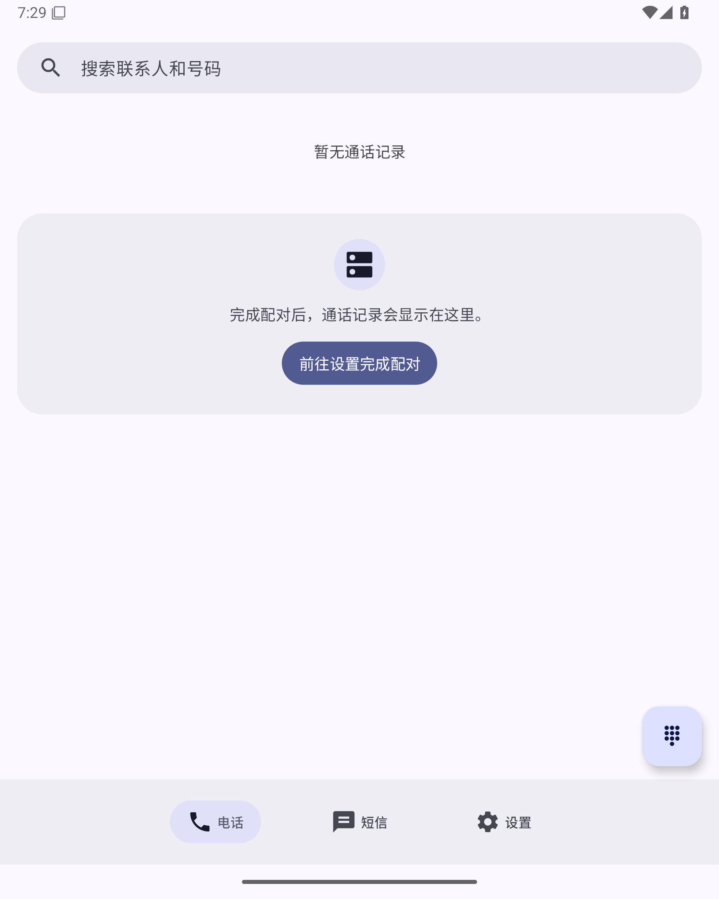
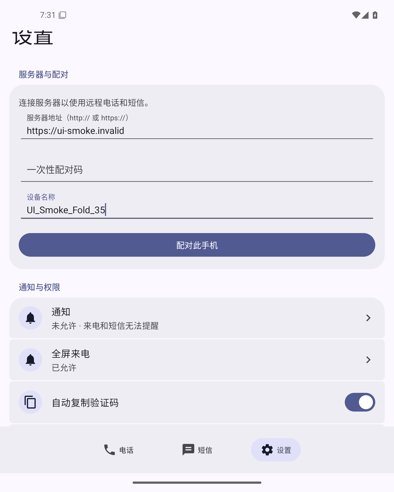
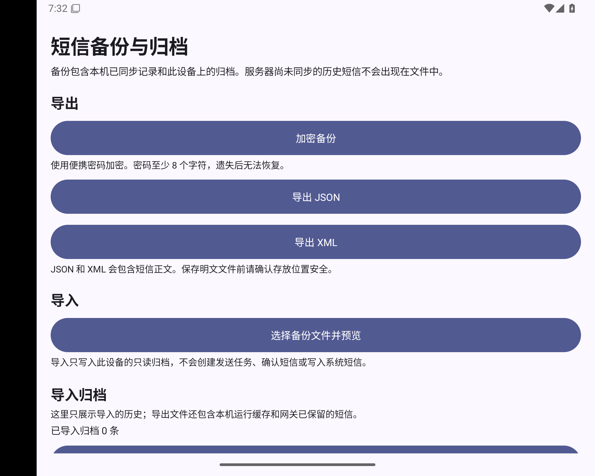
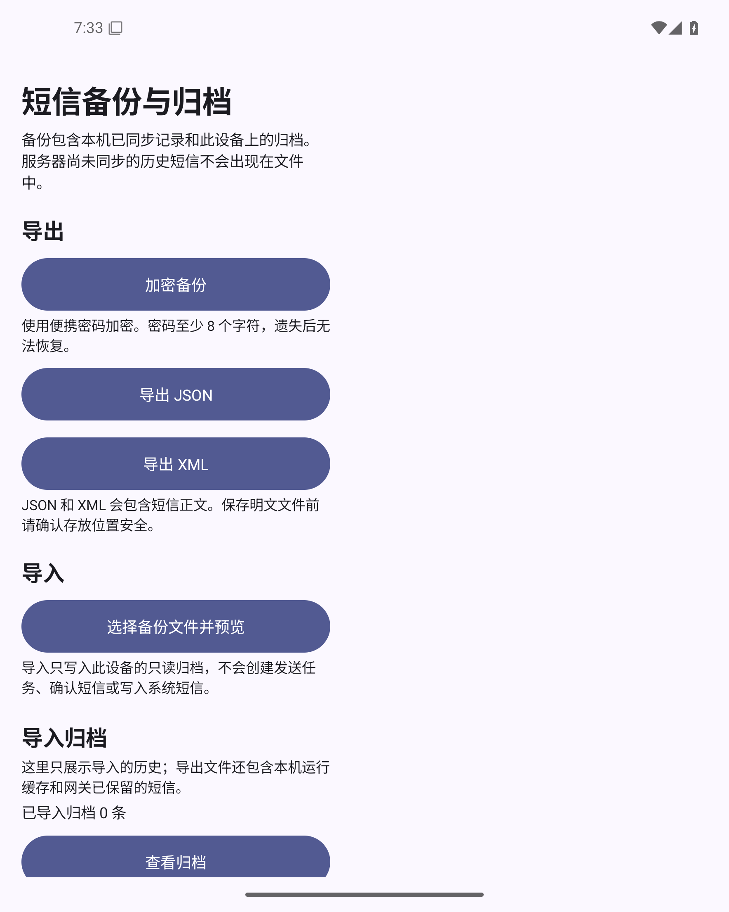
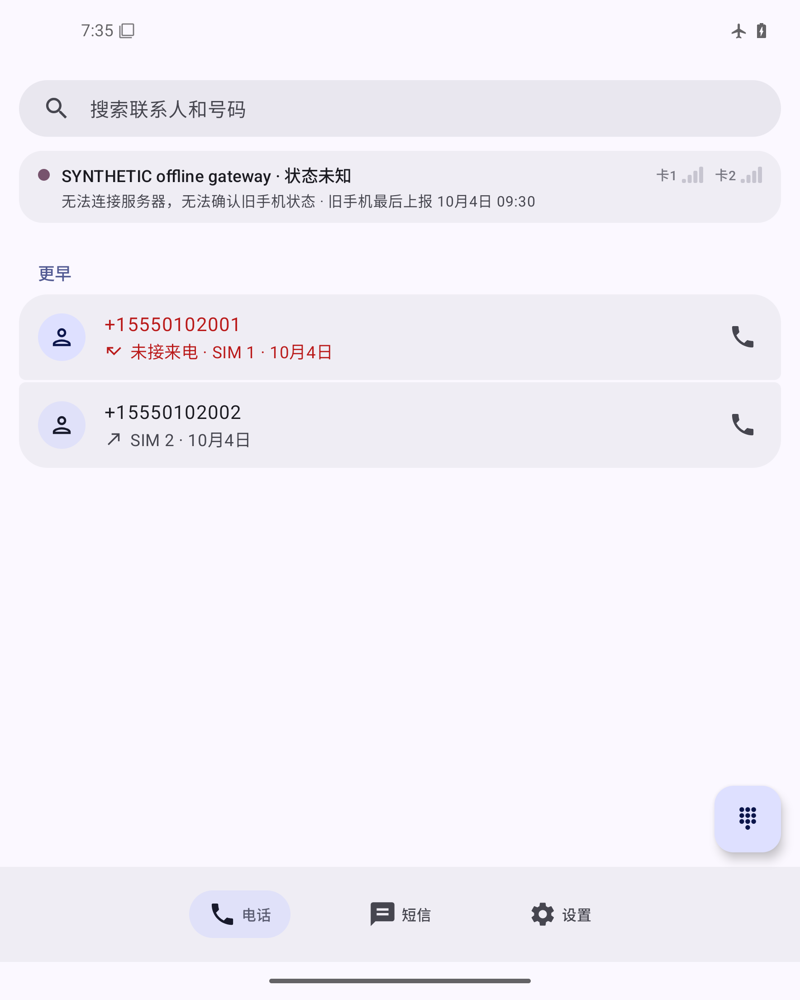
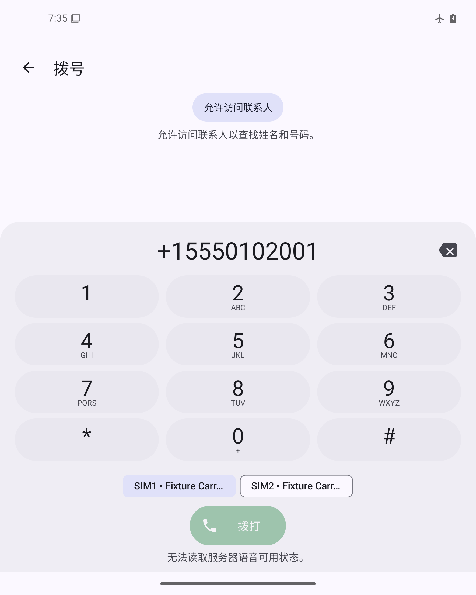
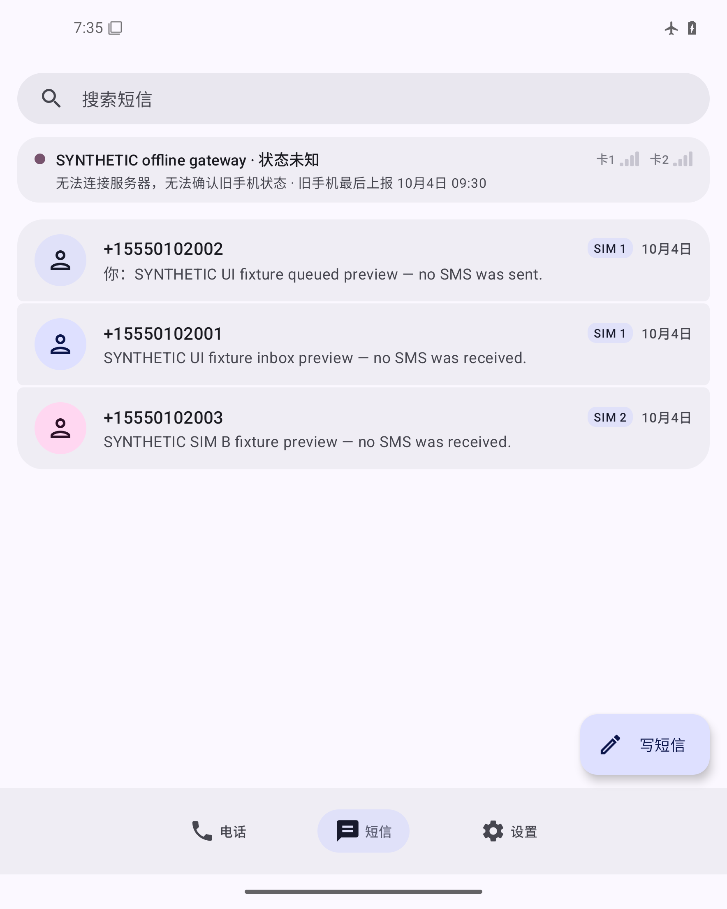
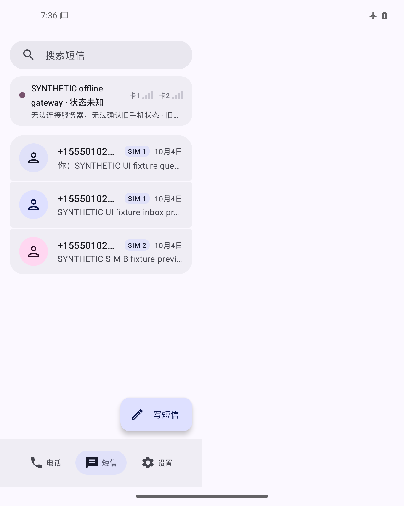
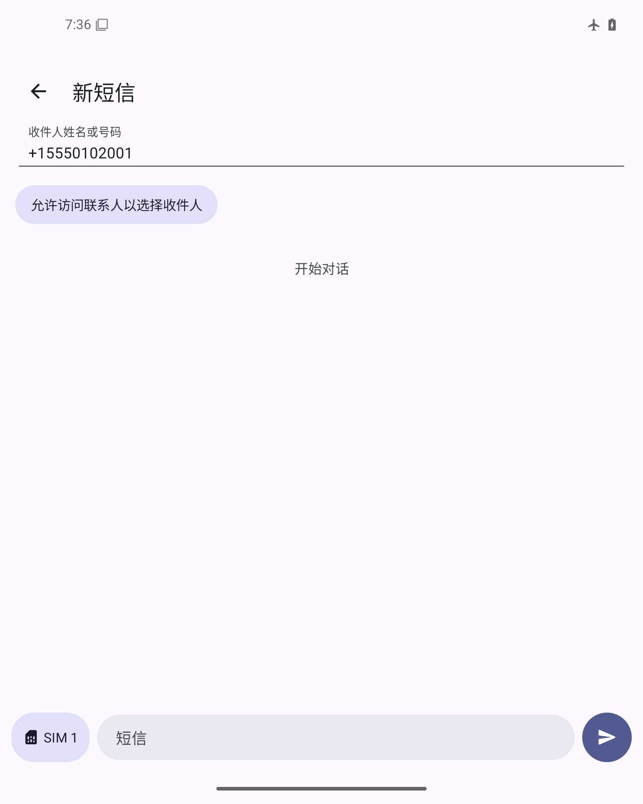
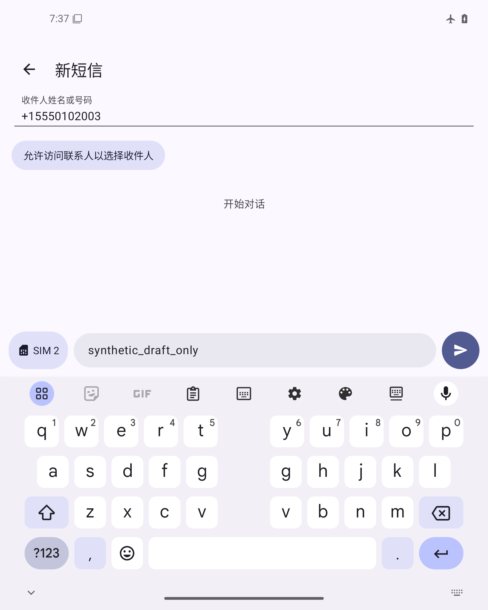

# Android 主机三标签 UI 验证

本报告由通过的 Android 35、7.6 英寸折叠屏 KVM UI smoke artifact 自动生成。截图是 artifact 中原始 PNG 字节的逐字节副本。

## 运行来源

- 仓库：`KiriKira/Madoka`
- 源提交：`6ebb07d8256eb93b0503f5f5a85a760e19e22073`
- GitHub Actions run：[44258931173](https://github.com/KiriKira/Madoka/actions/runs/44258931173)
- artifact ID：`14408116107`
- artifact digest：`sha256:d6d502ffbc823f503c4de9570f424a4ecb67f5df14a7105547199e019676e2da`
- APK：`app-debug.apk`，SHA-256 `afec5fc3bdb606bc5fddc1f6eb4e66eb452cd99710d193e2990ecec3efc1104a`，22516128 字节
- artifact 内未配对 smoke：`pass`（2026-11-18T07:34:48.116892+00:00）
- artifact 内配对 fixture：`pass`（2026-11-18T07:38:38.525195+00:00）
- 报告生成时间：`2026-11-18T07:38:51Z`

## 验证范围

未配对流程覆盖电话记录页、拨号键盘、短信列表、设置与备份入口，以及窗口旋转、折叠、展开和挖孔安全区。配对 fixture 使用离线合成的会话、两张 SIM、三条短信和通话记录；新建短信草稿经历 IME、旋转、折叠和展开。

四张出站准备、通话中、通话键盘和来电截图来自进程内合成 coordinator UI 状态；没有启动 SIP、Telecom、音频或蜂窝通话，未发送或接收短信。配对 fixture 结果要求 `fixture_active_call_ui=pass`。

本报告只验证 Android Emulator 上的界面流程，不代表 Z Fold8 真机、真实 SIM 短信收发、SIP 注册或双向语音已完成设备验收。

## 截图与文件校验

| 页面 | PNG | 尺寸 | 文件 SHA-256 |
|---|---|---:|---|
| 三标签导航 | [`images/host_navigation_initial.png`](images/host_navigation_initial.png) | 1768 × 2208 | `7b3172f3fa2546b61137d6f21a8a870a05efce430cde13d5772487dc40b9fc38` |
| 未配对电话记录页 | [`images/host_call_history.png`](images/host_call_history.png) | 1768 × 2208 | `858354cea633430b8925d4e1aac3e2a321a8d5964e078bfc3bef2eb2d2b3bf39` |
| 独立拨号键盘 | [`images/host_dialpad.png`](images/host_dialpad.png) | 1768 × 2208 | `ab87a2e6f3e6ac2b8741b3ee099cdb13ebb63b9452e2fdaf8ef9860e5dc3247b` |
| 短信会话列表 | [`images/host_sms_thread_list.png`](images/host_sms_thread_list.png) | 1768 × 2208 | `aa8f3f5fef1b00560edf0a9d04af64e4571af87d385d1846d14f92d3b583a875` |
| 设置与配对表单 | [`images/host_settings_tab.png`](images/host_settings_tab.png) | 1768 × 2208 | `932bf38b66c4831acb3ae2ff189fc1052c993eca1c82ad26a646c944ee4f2b2f` |
| 设置中的短信备份入口 | [`images/host_settings_backup_entry.png`](images/host_settings_backup_entry.png) | 1768 × 2208 | `31582fc2bc8ab76ee153eb1d7b45109e431981e13e7cc5baa5bbf2f051f9b82b` |
| 主界面合拢窗口 | [`images/folded_ui.png`](images/folded_ui.png) | 1768 × 2208 | `24aa37fd4eed188bb35244caf35bb6c42be50619eb6bb952f8d6028c53c381f7` |
| 主界面展开窗口 | [`images/unfolded_ui.png`](images/unfolded_ui.png) | 1768 × 2208 | `4efc55ceab050306bc189f40f0ae304cbc3b0d16b4a4473add49e246af0ce9d2` |
| 显示挖孔时的主界面 | [`images/hole_cutout_enabled.png`](images/hole_cutout_enabled.png) | 1768 × 2208 | `ff676586dab4caf91db7a1e226288aa9b86494a824a3fff97a4573099eee0903` |
| 滚动后可见的备份入口 | [`images/main-backup-entry-host.png`](images/main-backup-entry-host.png) | 1768 × 2208 | `d325c145fa5c00ec48230c492e25501826e5f3a82915db9fdaac6c67f9434a10` |
| 短信备份与归档页面 | [`images/backup-overview.png`](images/backup-overview.png) | 1768 × 2208 | `d580c5326be6466e3a64ee08581592df23c4c2589fbe0c239265d143a73506b0` |
| 备份页面横屏 | [`images/backup-rotation-landscape.png`](images/backup-rotation-landscape.png) | 2208 × 1768 | `eacd8a44879202a3ed0166732423d21eb953d30db4357fbef7fa87ed351c7c87` |
| 备份页面竖屏 | [`images/backup-rotation-portrait.png`](images/backup-rotation-portrait.png) | 1768 × 2208 | `aaff5314f82a790faf07db5aabf78ce1971e303f0171aadc0dc46dfd21e50c65` |
| 备份页面合拢 | [`images/backup-folded.png`](images/backup-folded.png) | 1768 × 2208 | `e8d8dfa5768f608dce367162df498112566efb4b1cb8feacaddbee25a6fe28f0` |
| 备份页面展开 | [`images/backup-unfolded.png`](images/backup-unfolded.png) | 1768 × 2208 | `aaff5314f82a790faf07db5aabf78ce1971e303f0171aadc0dc46dfd21e50c65` |
| 挖孔安全区中的备份页面 | [`images/backup-cutout.png`](images/backup-cutout.png) | 1768 × 2208 | `aaff5314f82a790faf07db5aabf78ce1971e303f0171aadc0dc46dfd21e50c65` |
| 合成短信归档导入预览 | [`images/backup-import-preview.png`](images/backup-import-preview.png) | 1768 × 2208 | `5047e7ca4bf374a4323018db25daa106828c8f96f90777a446fc8167b0c2e7fd` |
| 导入后的归档历史 | [`images/backup-imported-history.png`](images/backup-imported-history.png) | 1768 × 2208 | `2125bdbec370e96c497b5dd8548f07ef18a7a7a700df1b506e7536d2ee20c94d` |
| 配对状态下的三标签 | [`images/paired-fixture/paired_three_tabs.png`](images/paired-fixture/paired_three_tabs.png) | 1768 × 2208 | `53d9381e9cfa7f49d9ac36f522ed850d10e05255f4ee15f7693a8b61959ff94f` |
| 双 SIM 合成通话记录 | [`images/paired-fixture/paired_call_history.png`](images/paired-fixture/paired_call_history.png) | 1768 × 2208 | `6ead0cb575361928e0b997a42f88d81bde34430cee210f5895a57084ea79baf0` |
| 从通话记录预填号码的拨号页 | [`images/paired-fixture/paired_dialpad_from_history.png`](images/paired-fixture/paired_dialpad_from_history.png) | 1768 × 2208 | `2c8a2a96da7451971bc53c22e10f695b1ab2989e2ae11fde325b4c63636c0058` |
| 配对状态下的独立拨号键盘 | [`images/paired-fixture/paired_dialpad.png`](images/paired-fixture/paired_dialpad.png) | 1768 × 2208 | `2c8a2a96da7451971bc53c22e10f695b1ab2989e2ae11fde325b4c63636c0058` |
| 三条合成短信会话 | [`images/paired-fixture/paired_sms_threads.png`](images/paired-fixture/paired_sms_threads.png) | 1768 × 2208 | `047c155c4e5cc76b7f9940dcc5f303ea27df7680136dc282e1bdd238ea4a9b21` |
| 合拢窗口中的短信会话 | [`images/paired-fixture/paired_sms_threads_folded.png`](images/paired-fixture/paired_sms_threads_folded.png) | 1768 × 2208 | `e0d2789a0cd9bded7d402943753423a7f2ddf66fd49f61c861bd7929422286aa` |
| 展开窗口中的短信会话 | [`images/paired-fixture/paired_sms_threads_unfolded.png`](images/paired-fixture/paired_sms_threads_unfolded.png) | 1768 × 2208 | `ca075d6b2aea30368e93c3c994de733c265dbe73885eaf3851eb585d742669bd` |
| 既有短信对话与回复框 | [`images/paired-fixture/paired_sms_conversation.png`](images/paired-fixture/paired_sms_conversation.png) | 1768 × 2208 | `1ce15bb24d2e6601b52d8eb0f7975a32f742b6cbb02ef7059b909fe20e09b413` |
| 新短信编辑页 | [`images/paired-fixture/paired_new_message.png`](images/paired-fixture/paired_new_message.png) | 1768 × 2208 | `613a395404fc5e8db754df7046c11e5596f9574aaafe7bf2351b4f40946cd734` |
| 选择 SIM 2 的新短信页 | [`images/paired-fixture/paired_new_message_sim_b.png`](images/paired-fixture/paired_new_message_sim_b.png) | 1768 × 2208 | `10500f22ad1f49bcdab58c2719a04d0d729330e7fd856786e712e91ad1f375a4` |
| 横屏且键盘显示时的短信草稿 | [`images/paired-fixture/paired_new_message_landscape.png`](images/paired-fixture/paired_new_message_landscape.png) | 2208 × 1768 | `89249a9e491c02f472cd6aa4d03ee3b55f04562fee5ca253a57a665178e3c46d` |
| 合拢窗口中的短信草稿 | [`images/paired-fixture/paired_new_message_folded.png`](images/paired-fixture/paired_new_message_folded.png) | 1768 × 2208 | `fab9c06e37baa91f6a0320bf9795aaf98f5a519b4f52406e8d964b79cd21ae1e` |
| 展开窗口中的短信草稿 | [`images/paired-fixture/paired_new_message_unfolded.png`](images/paired-fixture/paired_new_message_unfolded.png) | 1768 × 2208 | `0eddc62a7d5728cac90045d791d07ef1e080f78de43d98c864424542c228b8cd` |
| 配对状态下的设置 | [`images/paired-fixture/paired_settings.png`](images/paired-fixture/paired_settings.png) | 1768 × 2208 | `76c8a07d8e1663e2b4bea2caaa25aa7fc92a2b4067b8fa0c870a1da25a71e3a1` |
| 配对设置中的短信备份入口 | [`images/paired-fixture/paired_settings_backup.png`](images/paired-fixture/paired_settings_backup.png) | 1768 × 2208 | `14230a6c626bf4317ade3ba6909d6b612523f6523b1882600a4f827dbedecf58` |
| 合成出站呼叫准备界面 | [`images/paired-fixture/call-synthetic-dialing.png`](images/paired-fixture/call-synthetic-dialing.png) | 1768 × 2208 | `1ff5669a4365931341f0cae1a18e86f72177309a9a89593de369e03a0c698664` |
| 合成通话中界面 | [`images/paired-fixture/call-synthetic-active.png`](images/paired-fixture/call-synthetic-active.png) | 1768 × 2208 | `a05b8cc848ed44cb9fedeabe42d58e61f6e318cd24e5660785e745b6a010cb75` |
| 合成通话键盘界面 | [`images/paired-fixture/call-synthetic-keypad.png`](images/paired-fixture/call-synthetic-keypad.png) | 1768 × 2208 | `e24134cdfa0ebf7c2cf3def788f24b306f43e6f8186f44c4dfe4e60d885f5fef` |
| 合成来电界面 | [`images/paired-fixture/call-synthetic-incoming.png`](images/paired-fixture/call-synthetic-incoming.png) | 1768 × 2208 | `2632e23525de56aec85965541ec600b0937290be410cf402b6f05a9c62f3fa04` |

## 截图

### 未配对界面

#### 三标签导航

### 电话与拨号

#### 未配对电话记录页

#### 独立拨号键盘

### 短信

#### 短信会话列表

### 设置

#### 设置与配对表单

#### 设置中的短信备份入口

### 窗口适配

#### 主界面合拢窗口

#### 主界面展开窗口

#### 显示挖孔时的主界面

### 短信备份

#### 滚动后可见的备份入口

#### 短信备份与归档页面

#### 备份页面横屏

#### 备份页面竖屏

#### 备份页面合拢

#### 备份页面展开

#### 挖孔安全区中的备份页面

#### 合成短信归档导入预览

#### 导入后的归档历史

### 配对数据界面

#### 配对状态下的三标签

#### 双 SIM 合成通话记录

#### 从通话记录预填号码的拨号页

#### 配对状态下的独立拨号键盘

#### 三条合成短信会话

#### 合拢窗口中的短信会话

#### 展开窗口中的短信会话

#### 既有短信对话与回复框

#### 新短信编辑页

#### 选择 SIM 2 的新短信页

#### 横屏且键盘显示时的短信草稿

#### 合拢窗口中的短信草稿

#### 展开窗口中的短信草稿

#### 配对状态下的设置

#### 配对设置中的短信备份入口

### 合成通话界面

#### 合成出站呼叫准备界面

#### 合成通话中界面

#### 合成通话键盘界面

#### 合成来电界面

## 结果文件校验

| artifact 文件 | SHA-256 |
|---|---|
| `results.json` | `e119a8b18830c6ab92539d55d0c14ab48167a3f2cde27b756d39a282fb9f7638` |
| `screenshot_manifest.json` | `579db39efc51dc5fe771206d3b4bc88a0abf129628ffa353e1b2786b213c7498` |
| `paired-fixture/results.json` | `17d074786011e63b86a15da212a895a5187124a60cb52884a5752d99140bd65f` |
| `paired-fixture/fixture_manifest.json` | `8e619de920e214e7c87373671b0caa1348fd5f7e90e749f169e18ba5b94f0396` |

初始评审材料保留在 `images-initial/`、`initial-evidence.json`、`initial-ui-results.json` 和 `local-checks.json`；它们与本次通过的 KVM 截图分开保存。机器可读运行信息见 [`verified-run.json`](verified-run.json)。
