# Android 主机三标签 UI 验证

本报告由通过的 Android 35、7.6 英寸折叠屏 KVM UI smoke artifact 自动生成。截图是 artifact 中原始 PNG 字节的逐字节副本。

## 运行来源

- 仓库：`KiriKira/Madoka`
- 源提交：`cc9e4a3851c98e51d7b619ccded4887916f256d7`
- GitHub Actions run：[44134190081](https://github.com/KiriKira/Madoka/actions/runs/44134190081)
- artifact ID：`14352401823`
- artifact digest：`sha256:0b1422afccfe996f2fb340806b34705d69c7ae6964ed4edb28292d499ec41634`
- APK：`app-debug.apk`，SHA-256 `0366a1190eba7d6bf2ba149f437756d93367ece71b587671efbfca9d35b858d6`，22516128 字节
- artifact 内未配对 smoke：`pass`（2026-11-17T17:20:03.638355+00:00）
- artifact 内配对 fixture：`pass`（2026-11-17T17:23:49.255210+00:00）
- 报告生成时间：`2026-11-17T17:24:03Z`

## 验证范围

未配对流程覆盖电话记录页、拨号键盘、短信列表、设置与备份入口，以及窗口旋转、折叠、展开和挖孔安全区。配对 fixture 使用离线合成的会话、两张 SIM、三条短信和通话记录；新建短信草稿经历 IME、旋转、折叠和展开。

四张出站准备、通话中、通话键盘和来电截图来自进程内合成 coordinator UI 状态；没有启动 SIP、Telecom、音频或蜂窝通话，未发送或接收短信。配对 fixture 结果要求 `fixture_active_call_ui=pass`。

本报告只验证 Android Emulator 上的界面流程，不代表 Z Fold8 真机、真实 SIM 短信收发、SIP 注册或双向语音已完成设备验收。

## 截图与文件校验

| 页面 | PNG | 尺寸 | 文件 SHA-256 |
|---|---|---:|---|
| 三标签导航 | [`images/host_navigation_initial.png`](images/host_navigation_initial.png) | 1768 × 2208 | `e7a4bb8a73163abbe1b1e2d249469f8c24a378b49d677dd46548de44f1a601c8` |
| 未配对电话记录页 | [`images/host_call_history.png`](images/host_call_history.png) | 1768 × 2208 | `defea20690112c0184db5adcc490b3c6f22f607a5dd5ef6f74723aa3f5cf3129` |
| 独立拨号键盘 | [`images/host_dialpad.png`](images/host_dialpad.png) | 1768 × 2208 | `3866b6da7f5970a14d01ef89799dbfb2fc29fdae3ae7c42cca4365c74895d607` |
| 短信会话列表 | [`images/host_sms_thread_list.png`](images/host_sms_thread_list.png) | 1768 × 2208 | `8eb808d928e0fc1a53b4a62543fdd7c27129a9c480b7a569ef8c3185f562afd1` |
| 设置与配对表单 | [`images/host_settings_tab.png`](images/host_settings_tab.png) | 1768 × 2208 | `99639d79a81814bf62e2879d57bb2a65c4e36084154f6472596e95d001f5d8cd` |
| 设置中的短信备份入口 | [`images/host_settings_backup_entry.png`](images/host_settings_backup_entry.png) | 1768 × 2208 | `3885da659efa955012bcb44fa0a58c1f4ea33c240cd1fe8a44525c73bab92c01` |
| 主界面合拢窗口 | [`images/folded_ui.png`](images/folded_ui.png) | 1768 × 2208 | `4f3375758d897339cd45b6571c5cd679e669577aac90086e668493d2c9189feb` |
| 主界面展开窗口 | [`images/unfolded_ui.png`](images/unfolded_ui.png) | 1768 × 2208 | `78bcb3529570c3c6604e15b74b84136aa6d6423d7acac4ae6258bb0265b064c3` |
| 显示挖孔时的主界面 | [`images/hole_cutout_enabled.png`](images/hole_cutout_enabled.png) | 1768 × 2208 | `bcac8812c2322a98a8bd23a9c02828120f6d6a501441fd4943de6cfa8bbb9426` |
| 滚动后可见的备份入口 | [`images/main-backup-entry-host.png`](images/main-backup-entry-host.png) | 1768 × 2208 | `01b355c5899f2f2e8d07adaa71c7ac07d86646e779d4154b688d59e8d58ddab6` |
| 短信备份与归档页面 | [`images/backup-overview.png`](images/backup-overview.png) | 1768 × 2208 | `d1ceab5f29f2d5e5eccd480faec2f955043bbfa9f9768727a4f2352f504559e5` |
| 备份页面横屏 | [`images/backup-rotation-landscape.png`](images/backup-rotation-landscape.png) | 2208 × 1768 | `5c21a29d2d19ba6f6f8fce9d877750c45a498754711bced5e65c07e4d420fc3c` |
| 备份页面竖屏 | [`images/backup-rotation-portrait.png`](images/backup-rotation-portrait.png) | 1768 × 2208 | `11221d101991eb01ba5d092491d57d026b4bebc032286bd977bdd71f0ce345a4` |
| 备份页面合拢 | [`images/backup-folded.png`](images/backup-folded.png) | 1768 × 2208 | `ad30e20a4e5886cfc50ed2bbe0d3bb4209297f37a2a61137d276a787a4436bea` |
| 备份页面展开 | [`images/backup-unfolded.png`](images/backup-unfolded.png) | 1768 × 2208 | `11221d101991eb01ba5d092491d57d026b4bebc032286bd977bdd71f0ce345a4` |
| 挖孔安全区中的备份页面 | [`images/backup-cutout.png`](images/backup-cutout.png) | 1768 × 2208 | `11221d101991eb01ba5d092491d57d026b4bebc032286bd977bdd71f0ce345a4` |
| 合成短信归档导入预览 | [`images/backup-import-preview.png`](images/backup-import-preview.png) | 1768 × 2208 | `e3a1ad617b0537e2eaafd7d18f0bae2f99d1b6a577ed4dcbc8b4e4aaf748e6f2` |
| 导入后的归档历史 | [`images/backup-imported-history.png`](images/backup-imported-history.png) | 1768 × 2208 | `cc7a93c7fdfa6ffa9a8ea73081ca2c5009fba35e04f2fb1f1ea7e1103ed1b793` |
| 配对状态下的三标签 | [`images/paired-fixture/paired_three_tabs.png`](images/paired-fixture/paired_three_tabs.png) | 1768 × 2208 | `ab054a054e71008171e8a934b8573a3388e1d9b141c294fb01e45ff79a618832` |
| 双 SIM 合成通话记录 | [`images/paired-fixture/paired_call_history.png`](images/paired-fixture/paired_call_history.png) | 1768 × 2208 | `a1053b54d68b101f20a6fb5562ca06d59c42f28bec78e29d8139810faf37e2d6` |
| 从通话记录预填号码的拨号页 | [`images/paired-fixture/paired_dialpad_from_history.png`](images/paired-fixture/paired_dialpad_from_history.png) | 1768 × 2208 | `886b5840562408f6ea7575a49206a490a0d88b50cd2d82c4843a5da3269d5bb6` |
| 配对状态下的独立拨号键盘 | [`images/paired-fixture/paired_dialpad.png`](images/paired-fixture/paired_dialpad.png) | 1768 × 2208 | `886b5840562408f6ea7575a49206a490a0d88b50cd2d82c4843a5da3269d5bb6` |
| 三条合成短信会话 | [`images/paired-fixture/paired_sms_threads.png`](images/paired-fixture/paired_sms_threads.png) | 1768 × 2208 | `743a253ac2f4a46bf4631ecea31ff5cb6ce423c8362a9ba326cb1db1484953dd` |
| 合拢窗口中的短信会话 | [`images/paired-fixture/paired_sms_threads_folded.png`](images/paired-fixture/paired_sms_threads_folded.png) | 1768 × 2208 | `2623b63bcdd62f3b2d2f1f2d0aeec8ddc1a170c4b3b2a025c4b0357c510a6cbe` |
| 展开窗口中的短信会话 | [`images/paired-fixture/paired_sms_threads_unfolded.png`](images/paired-fixture/paired_sms_threads_unfolded.png) | 1768 × 2208 | `743a253ac2f4a46bf4631ecea31ff5cb6ce423c8362a9ba326cb1db1484953dd` |
| 既有短信对话与回复框 | [`images/paired-fixture/paired_sms_conversation.png`](images/paired-fixture/paired_sms_conversation.png) | 1768 × 2208 | `5500db52550ba4020854134595f60bb1ad2c91a2b1fa2d2d4c970b8c5aaf628d` |
| 新短信编辑页 | [`images/paired-fixture/paired_new_message.png`](images/paired-fixture/paired_new_message.png) | 1768 × 2208 | `e07c0cf706ce781cc3c7f2c7327c87f01120835f2ec1ab7e2ead5772c37cdbfb` |
| 选择 SIM 2 的新短信页 | [`images/paired-fixture/paired_new_message_sim_b.png`](images/paired-fixture/paired_new_message_sim_b.png) | 1768 × 2208 | `2e1a9db98667756e513793596bfa9bddc34b5da854708df9b833a28951d711a9` |
| 横屏且键盘显示时的短信草稿 | [`images/paired-fixture/paired_new_message_landscape.png`](images/paired-fixture/paired_new_message_landscape.png) | 2208 × 1768 | `d5ef7a366cd8e906f876288d9ee154a993b13a4fcbda7fd6d2984ab6861832f2` |
| 合拢窗口中的短信草稿 | [`images/paired-fixture/paired_new_message_folded.png`](images/paired-fixture/paired_new_message_folded.png) | 1768 × 2208 | `09186576a83e6aabeda666b4649d96459d8758e2d5d9b43b2c6e0e91aaaec66a` |
| 展开窗口中的短信草稿 | [`images/paired-fixture/paired_new_message_unfolded.png`](images/paired-fixture/paired_new_message_unfolded.png) | 1768 × 2208 | `9199e27cecfd497bb9490fbb06ad1ac703bdc147193e3ae38b2a3e561f80c9b4` |
| 配对状态下的设置 | [`images/paired-fixture/paired_settings.png`](images/paired-fixture/paired_settings.png) | 1768 × 2208 | `e5a33c2449b6a79fceac6dbcd201210eb86ce1a181f4273d765e99b86510e179` |
| 配对设置中的短信备份入口 | [`images/paired-fixture/paired_settings_backup.png`](images/paired-fixture/paired_settings_backup.png) | 1768 × 2208 | `92dfdb651d79955dc902962f8f894defdf0d67ef669daf6bba4cbef26f07b11b` |
| 合成出站呼叫准备界面 | [`images/paired-fixture/call-synthetic-dialing.png`](images/paired-fixture/call-synthetic-dialing.png) | 1768 × 2208 | `4234c5d2f88c57a8f1707e28cb06c3f153e058f528d33d67a11051d1d21b5299` |
| 合成通话中界面 | [`images/paired-fixture/call-synthetic-active.png`](images/paired-fixture/call-synthetic-active.png) | 1768 × 2208 | `d08e3b073042be86cda3305b99917b3fb4a1b8db8c25f843bf043e0b82e053e6` |
| 合成通话键盘界面 | [`images/paired-fixture/call-synthetic-keypad.png`](images/paired-fixture/call-synthetic-keypad.png) | 1768 × 2208 | `b53143afc4c9704aa8dc3a87c12eaa00b55e09451b5736fb49f986c4ac5f006c` |
| 合成来电界面 | [`images/paired-fixture/call-synthetic-incoming.png`](images/paired-fixture/call-synthetic-incoming.png) | 1768 × 2208 | `3ae9de862c4c7a83a2c204008f495899232cfd4436f7b39ccab27d0a30b09adc` |

## 截图

### 未配对界面

#### 三标签导航

### 电话与拨号

#### 未配对电话记录页

#### 独立拨号键盘

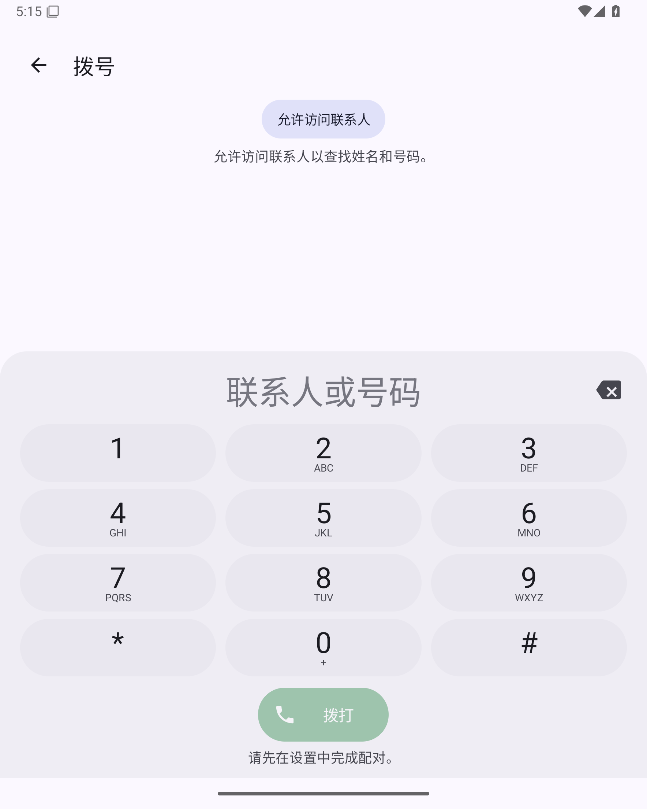

### 短信

#### 短信会话列表

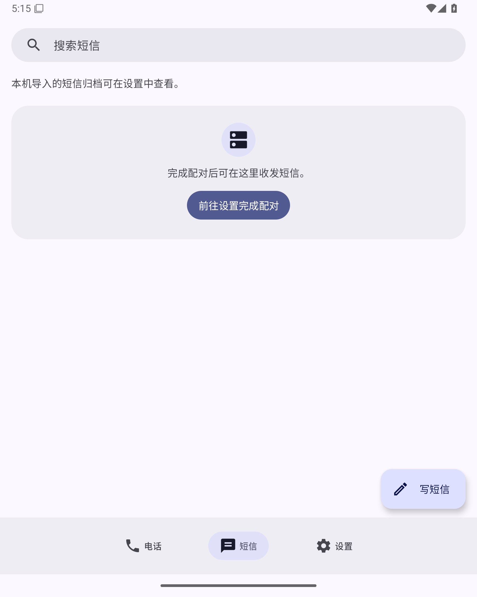

### 设置

#### 设置与配对表单

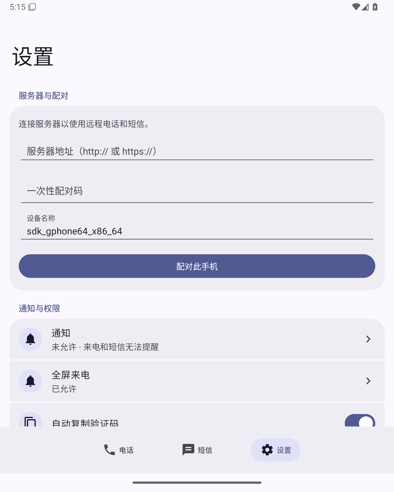

#### 设置中的短信备份入口

### 窗口适配

#### 主界面合拢窗口

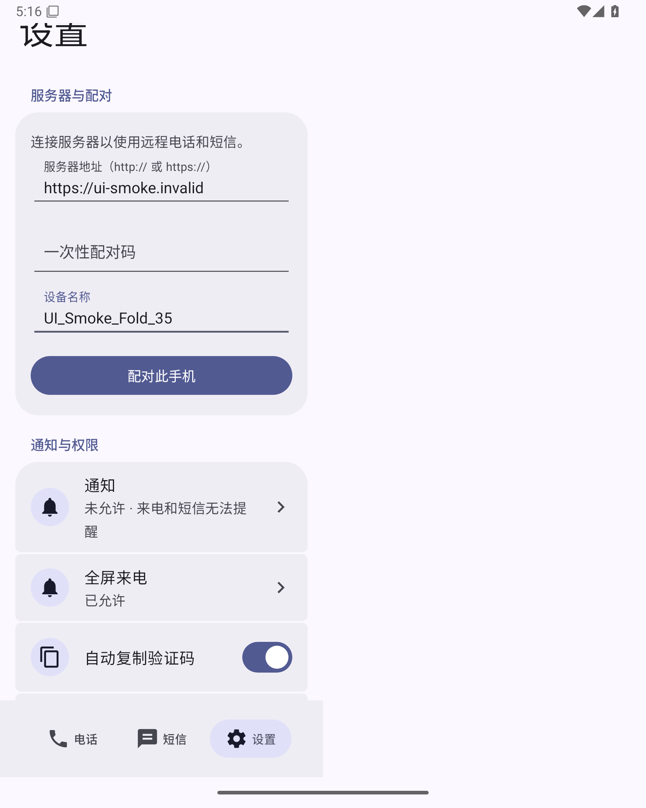

#### 主界面展开窗口

#### 显示挖孔时的主界面

### 短信备份

#### 滚动后可见的备份入口

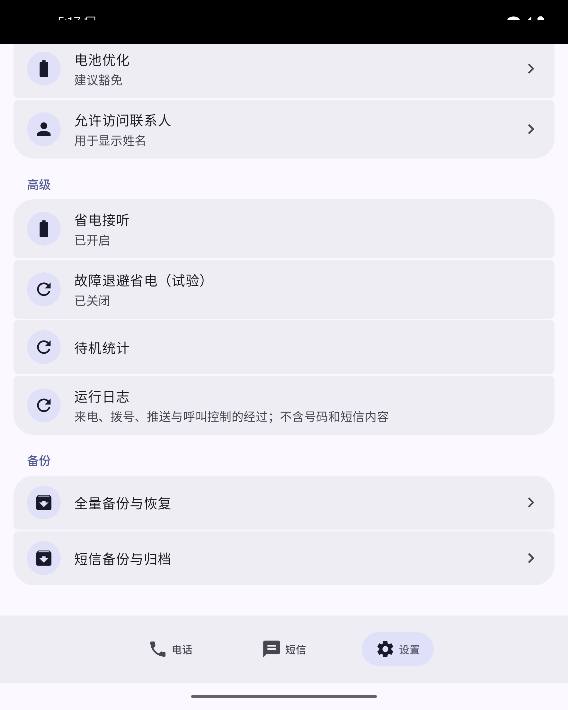

#### 短信备份与归档页面

#### 备份页面横屏

#### 备份页面竖屏

#### 备份页面合拢

#### 备份页面展开

#### 挖孔安全区中的备份页面

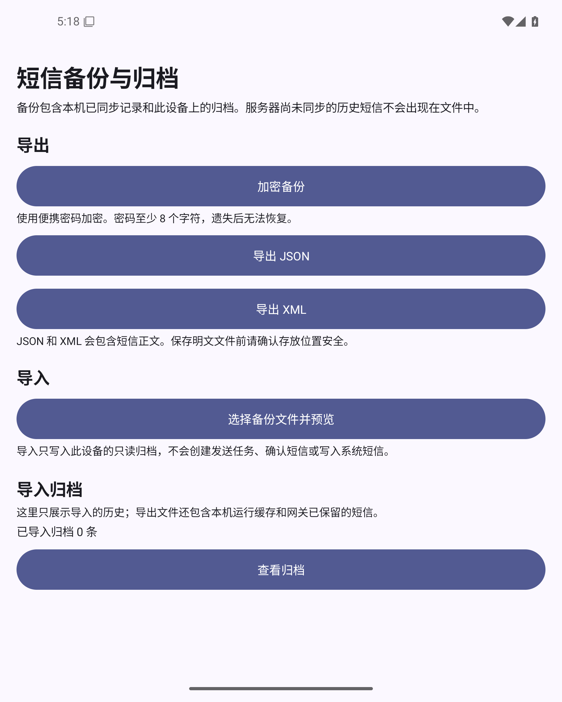

#### 合成短信归档导入预览

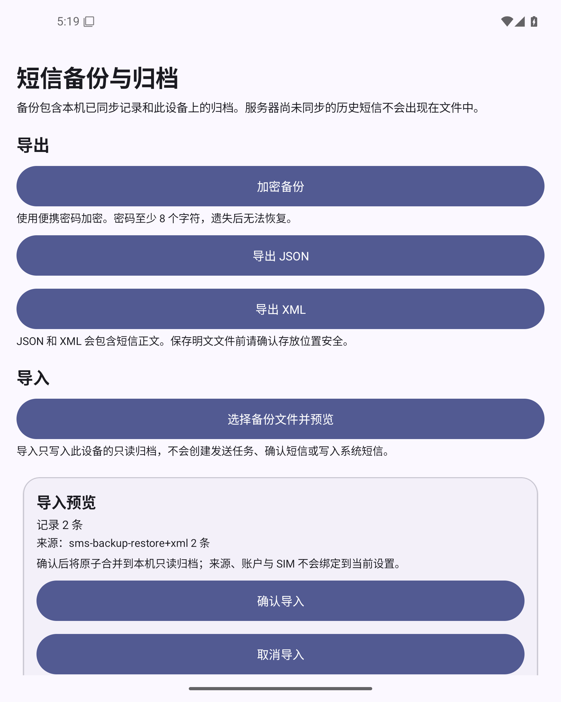

#### 导入后的归档历史

### 配对数据界面

#### 配对状态下的三标签

#### 双 SIM 合成通话记录

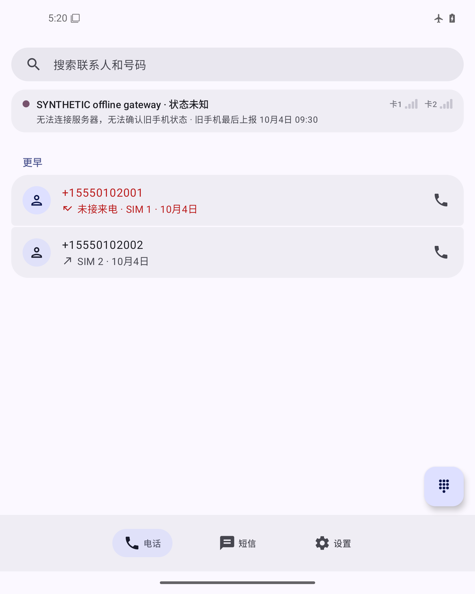

#### 从通话记录预填号码的拨号页

#### 配对状态下的独立拨号键盘

#### 三条合成短信会话

#### 合拢窗口中的短信会话

#### 展开窗口中的短信会话

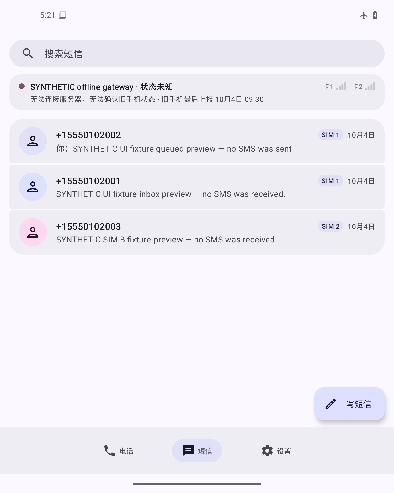

#### 既有短信对话与回复框

#### 新短信编辑页

#### 选择 SIM 2 的新短信页

#### 横屏且键盘显示时的短信草稿

#### 合拢窗口中的短信草稿

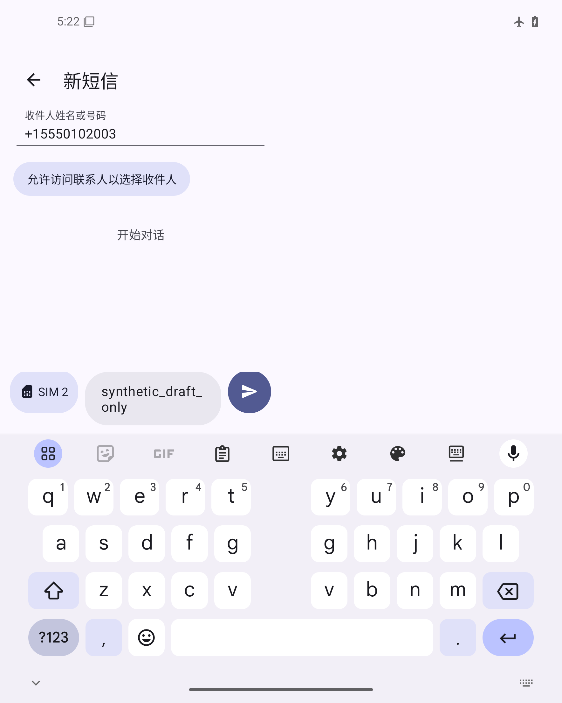

#### 展开窗口中的短信草稿

#### 配对状态下的设置

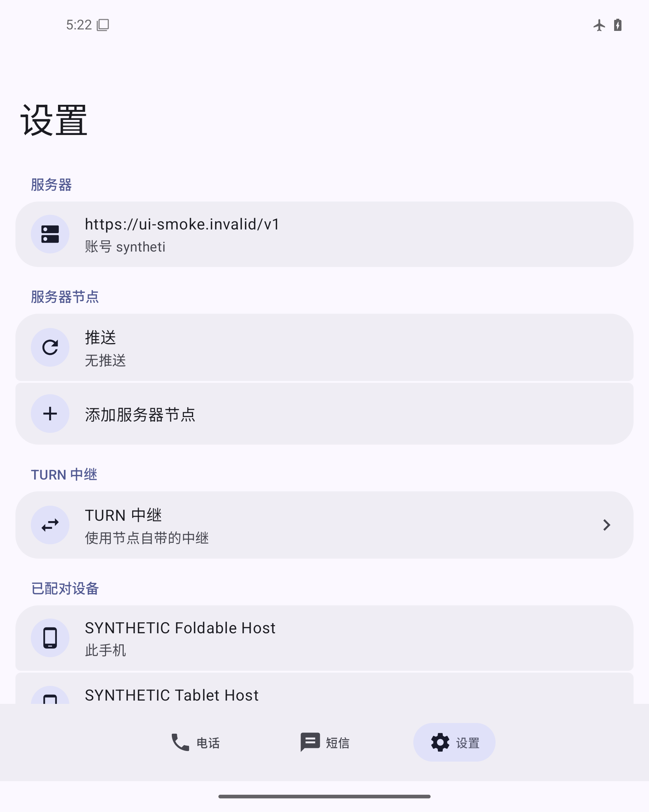

#### 配对设置中的短信备份入口

### 合成通话界面

#### 合成出站呼叫准备界面

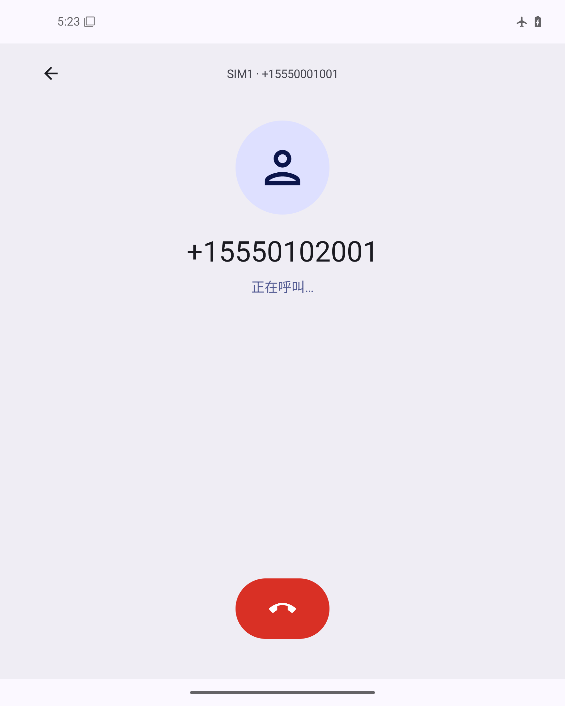

#### 合成通话中界面

#### 合成通话键盘界面

#### 合成来电界面

## 结果文件校验

| artifact 文件 | SHA-256 |
|---|---|
| `results.json` | `0267c595a1e5c04206b0907cbdbdbb6d63c8cd2f1db1809e793a95fa7eb2ffd3` |
| `screenshot_manifest.json` | `76a51de796cafda8a72b09343aedb8629e36b479ae7f5385cf0b5b8f7898ac23` |
| `paired-fixture/results.json` | `d40a98694e288eebfa114841d6b2fcf6bdc5bb1f7c6514419d93089c01edf138` |
| `paired-fixture/fixture_manifest.json` | `ddde7dbd82ef53af2cff1eb43de8ee3867083f9ae7cbd496cda2aa92cbe2ba37` |

初始评审材料保留在 `images-initial/`、`initial-evidence.json`、`initial-ui-results.json` 和 `local-checks.json`；它们与本次通过的 KVM 截图分开保存。机器可读运行信息见 [`verified-run.json`](verified-run.json)。
